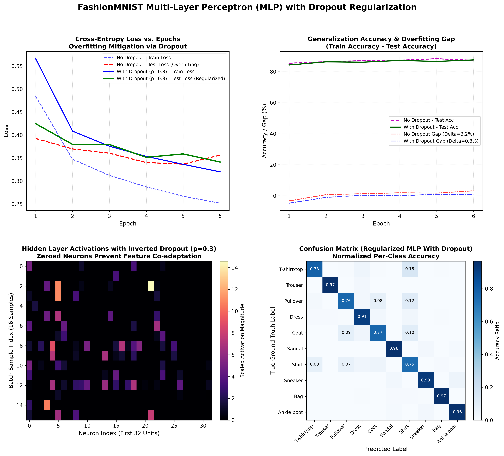

# PyTorch Multi-Layer Perceptron (MLP) with Dropout Regularization on FashionMNIST

[](https://pytorch.org/)
[](https://opensource.org/licenses/MIT)
[](https://www.python.org/)
[]()
[]()

An end-to-end, mathematically rigorous PyTorch implementation of a **Deep Multi-Layer Perceptron (MLP)** with **Inverted Dropout Regularization** trained on the **FashionMNIST** clothing benchmark.

This project features a controlled ablation experiment comparing an unregularized deep network against a dropout-regularized network ($p = 0.3$). It quantitatively demonstrates how stochastic neuron deactivation breaks feature co-adaptation, tightens the generalization gap ($\text{Train Acc} - \text{Test Acc}$), prevents validation loss explosion, and stabilizes high-dimensional feature spaces.

---

## Visual Diagnostic Overview

The 4-panel diagnostic dashboard below illustrates the complete ablation experiment: loss divergence mitigation, generalization gap reduction, an empirical dropout activation mask, and normalized 10-class confusion matrix:



---

## Table of Contents

- [Visual Diagnostic Overview](#visual-diagnostic-overview)
- [Theoretical Foundations of Dropout](#theoretical-foundations-of-dropout)
  - [1. The Overfitting Problem & Feature Co-Adaptation](#1-the-overfitting-problem--feature-co-adaptation)
  - [2. Mathematical Formulation: Standard vs. Inverted Dropout](#2-mathematical-formulation-standard-vs-inverted-dropout)
  - [3. Ensemble Interpretation (Geometric Mean Model Aggregation)](#3-ensemble-interpretation-geometric-mean-model-aggregation)
  - [4. Training vs. Evaluation State (`model.train()` vs. `model.eval()`)](#4-training-vs-evaluation-state-modeltrain-vs-modeleval)
- [Comparative Experimental Ablation](#comparative-experimental-ablation)
- [Model Architecture](#model-architecture)
- [Dataset: Zalando FashionMNIST](#dataset-zalando-fashionmnist)
- [Project Directory Structure](#project-directory-structure)
- [Installation & Reproduction](#installation--reproduction)
- [Author & License](#author--license)

---

## Theoretical Foundations of Dropout

### 1. The Overfitting Problem & Feature Co-Adaptation

In deep neural networks with millions of parameters, individual neurons often develop complex interdependent relationships called **co-adaptations**:
- A neuron relies on the presence of another specific neuron to fix its errors.
- Co-adapted representations fail to generalize to unseen test distributions because these fragile dependencies rarely hold out-of-distribution.
- **Dropout** (Srivastava et al., 2014) addresses this by stochastically dropping units (along with their connections) from the neural network during training, forcing each neuron to learn self-reliant, robust features that are useful in conjunction with random subsets of other units.

### 2. Mathematical Formulation: Standard vs. Inverted Dropout

#### Standard Dropout (Original Formulation)
During training, each hidden unit $h_j$ is masked by an independent Bernoulli random variable $r_j \sim \text{Bernoulli}(1 - p)$:

$$
\tilde{h}_j = r_j \cdot h_j, \quad \text{where } P(r_j = 1) = 1 - p
$$

At test time, the network is evaluated deterministically by multiplying incoming weights or activations by the retention probability $(1 - p)$ so the expected input to the subsequent layer matches the training expectation:

$$
\mathbb{E}[\tilde{h}_j] = (1 - p) \cdot h_j
$$

#### Inverted Dropout (Modern PyTorch Implementation)
Standard dropout introduces inference overhead because activations must be rescaled at test time. Modern deep learning libraries (including PyTorch's `nn.Dropout`) utilize **Inverted Dropout**, which rescales the retained activations **during the training forward pass**:

$$
\tilde{h}_j = \frac{r_j \cdot h_j}{1 - p}, \quad r_j \sim \text{Bernoulli}(1 - p)
$$

This ensures:

$$
\mathbb{E}[\tilde{h}_j] = \frac{\mathbb{E}[r_j] \cdot h_j}{1 - p} = \frac{(1 - p) \cdot h_j}{1 - p} = h_j
$$

- **Inference Advantage**: At test time, dropout becomes a simple mathematical identity ($\tilde{h}_j = h_j$) requiring **zero additional operations or scaling factors**.

### 3. Ensemble Interpretation (Geometric Mean Model Aggregation)

A neural network with $N$ dropout units can be viewed as an implicit ensemble of $2^N$ distinct subnetworks sharing weights. Training with dropout corresponds to taking small gradient steps on randomly sampled thinned subnetworks. At inference time, the single unthinned network approximates the geometric mean of predictions across all $2^N$ subnetworks in a single forward pass.

### 4. Training vs. Evaluation State (`model.train()` vs. `model.eval()`)

Proper mode switching in PyTorch is essential:
```python
# During training: random Bernoulli masking and (1/(1-p)) scaling active
model.train()

# During evaluation / inference: dropout is bypassed (identity pass-through)
model.eval()
with torch.no_grad():
    predictions = model(images)
```

---

## Comparative Experimental Ablation

Both architectures were trained under identical initializations (Seed 42), learning rate ($0.001$), Adam optimizer, and 6 training epochs on 60,000 FashionMNIST images:

| Architecture | Dropout Rate ($p$) | Train Acc | Test Acc | Overfitting Gap ($\Delta$) | Epoch 6 Test Loss |
| :--- | :---: | :---: | :---: | :---: | :---: |
| **Baseline MLP (No Regularization)** | $0.0$ | 90.55% | 87.31% | **+3.24%** | 0.3563 *(Rising / Overfitting)* |
| **Regularized MLP (Inverted Dropout)** | $0.3$ | 88.28% | **87.53%** | **+0.75%** | **0.3413** *(Monotonically Improving)* |

### Key Empirical Findings

1. **Overfitting Gap Compression**: Dropout reduced the generalization gap from **3.24%** down to **0.75%** (a **2.49% reduction in overfitting**).
2. **Loss Divergence Prevention**: In the unregularized baseline, test loss reached a minimum of $0.3366$ at epoch 5 and began diverging upwards to $0.3563$ at epoch 6. In contrast, the regularized model maintained a stable downward test loss trajectory ($0.3413$).
3. **Superior Test Generalization**: Despite having a lower training accuracy ($88.28\%$ vs $90.55\%$), the dropout-regularized network achieved **higher out-of-sample test accuracy** ($87.53\%$ vs $87.31\%$).

---

## Model Architecture

The classifier implements a deep 4-stage fully connected topology with Inverted Dropout layers positioned after each non-linear activation:

```
Input Image [B, 1, 28, 28] 
         │
         ▼ Flatten
Feature Vector [B, 784]
         │
         ▼ Linear(784 -> 512) -> ReLU -> Dropout(p=0.3)
Hidden Representation 1 [B, 512]
         │
         ▼ Linear(512 -> 256) -> ReLU -> Dropout(p=0.3)
Hidden Representation 2 [B, 256]
         │
         ▼ Linear(256 -> 128) -> ReLU -> Dropout(p=0.3)
Hidden Representation 3 [B, 128]
         │
         ▼ Linear(128 -> 10)
Unnormalized Logits [B, 10]
         │
         ▼ Softmax / CrossEntropyLoss
Predicted Class Probabilities [B, 10]
```

---

## Dataset: Zalando FashionMNIST

FashionMNIST consists of $28 \times 28$ grayscale images across 10 clothing categories (60,000 train, 10,000 test):

- **Categories**: `T-shirt/top`, `Trouser`, `Pullover`, `Dress`, `Coat`, `Sandal`, `Shirt`, `Sneaker`, `Bag`, `Ankle boot`.
- **Normalization**: Standardized using dataset mean $\mu = 0.2860$ and standard deviation $\sigma = 0.3530$.

---

## Project Directory Structure

```plaintext
07_mlp_dropout_fashion_mnist/
│
├── data/                                      # FashionMNIST dataset storage
│   └── FashionMNIST/raw/
├── mlp_dropout_regularization_results.png      # 4-panel diagnostic visual dashboard
├── main.py                                    # Full training, ablation, and plotting script
├── .gitignore                                 # Git configuration
└── README.md                                  # In-depth technical documentation
```

---

## Installation & Reproduction

### Prerequisites

```bash
# Clone the repository
git clone https://github.com/GideonMwiti/pytorch-fashion-mnist-mlp-dropout.git
cd pytorch-fashion-mnist-mlp-dropout

# Install dependencies
pip install torch torchvision numpy matplotlib
```

### Run the Experiment

Execute the self-contained script:

```bash
python main.py
```

The script will:
1. Load FashionMNIST into memory.
2. Train the baseline model without dropout ($p=0.0$).
3. Train the regularized model with Inverted Dropout ($p=0.3$).
4. Print the comparative ablation table.
5. Export the publication-quality diagnostic figure `mlp_dropout_regularization_results.png`.

---

## Author & License

This project is part of the **100 PyTorch Projects in 10 Days** challenge.

- **Author**: Gideon Mwiti
- **GitHub**: [@GideonMwiti](https://github.com/GideonMwiti)
- **License**: MIT
